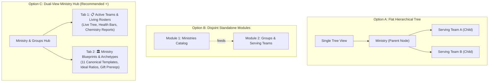

# 🌉 OpenEkklesia Smart Bridge v2: Framework Decision Matrix
**Comprehensive Architectural Synthesis, Model Comparison & Lead Architect Recommendation**
**Date:** 2026-08-25 | **Status:** Architectural Evaluation & Decision Document

---

## Executive Overview

Over the course of architectural review, four AI models (**Kimi**, **GLM**, **Gemini**, and **DeepSeek**) and the **OpenEkklesia Lead Team** evaluated how to evolve OpenEkklesia's Smart Bridge from a basic 1-to-1 attribute matcher into an **intelligent, pastorally-aware Team Composition and Group Dynamics Engine**.

This document aggregates all perspectives into a unified **Framework Decision Matrix**, evaluates trade-offs across 10 architectural dimensions, and outlines the **Lead Architect's Recommended "Golden Path"**.

---

## 1. Multi-Model Architectural Comparison Matrix

| Architectural Dimension | 🔍 Kimi Perspective | 🎨 GLM Perspective | 📐 Gemini Perspective | ⚡ DeepSeek Perspective | 🏆 Lead Architect Recommendation (Golden Path) |
| :--- | :--- | :--- | :--- | :--- | :--- |
| **1. Scoring Baseline & Floor** | Drop artificial 40pt base; normalize to true $0\text{--}100\%$ scale. | Start at 0 points; strictly accumulate based on genuine heuristic fit. | Zero-base starting point; dynamic vector calculation. | Zero-base; Sigmoid curve mapping raw ($0\text{--}250$) to $1\text{--}99\%$. | **Zero-Base ($0\text{ pts}$) + Bounded 0–100% Score**. Transparent, zero-inflation math. |
| **2. Relational Style / Archetype Model** | 5 Church-Contextual Archetypes (*Catalyst, Shepherd, Architect, Spark, Anchor*). | Focus on Primary/Secondary archetypes + pastoral tags. | 6 Relational Styles (*Organizer, Listener, Doer, Energizer, Strategist, Connector*). | 6 Relational Styles + Big Five personality traits + unified tag table. | **Dual-Layer Taxonomy**: 5 Primary/Secondary Church Archetypes in UI, mapped internally to 6 Functional Relational Styles. |
| **3. Team Composition & Dynamic Laws** | Gated eligibility + Missing role bonuses + Oversaturation limits. | Missing Piece bonus (+30) + Team Saturated penalty (-20) + Synergy pairs (+15). | **Three Laws**: Void Law (+25), Clash Law (-20), Equilibrium Law ($\Delta\text{Dist}$). | **Four Laws**: Void Law (+25), Clash Law (-20), Equilibrium ($\Delta\text{Dist}$), Interest Law (+35). | **Unified 4-Law Heuristics**: Void Boost, Clash Penalty, Equilibrium Distance Delta, Interest/Gifts Boost. |
| **4. Pre-Flight Hard Disqualifiers** | Serving load burnout ($\ge 3$), schedule clash, dead group ($>180\text{d}$), leader care flag. | Serving load burnout ($\ge \text{maxGroups}$), elected/closed groups, prior group departure. | Governance bodies (Board/Deacons), Closed/Seasonal cohorts. | Over-saturation ($\ge 3$ Strategists), At-Risk person into unstable team. | **Comprehensive Hard Gating**: Burnout limit, schedule clash, governance boards, closed cohorts, and leader care flags. |
| **5. Ministry vs. Group Module Structure** | Unify under Group creation with canonical archetype pre-fills. | Right Context Inspector integration with dual-panel UX. | Dedicated Ministry Genesis Wizard with radar charts. | `ministry_archetypes` catalog table + dynamic health score on groups. | **Option C: Dual-View Ministry Hub** (Tab 1: Active Groups & Rosters; Tab 2: Ministry Catalog & Blueprints). |
| **6. Skill & Spiritual Gift Matching** | Overlap ratio against declared requirements. | Proportional: $+10\text{ pts}$ per matched skill up to $+35\text{ pts}$ cap. | Domain keywords across 6 ministry areas. | Exact interest tag match (+20) + parent category match (+10) + gifts (+15). | **Proportional & Hierarchical Match**: $+10\text{ pts}$ per primary gift/skill match (capped at $+35\text{ pts}$). |
| **7. Geographic Proximity** | Drop raw ZIP code matching; use actual driving distance or co-attendance. | Expand to City OR host-home physical meeting ZIP code. | Group host address ZIP/City match + $\ge 2$ co-member proximity. | Exact ZIP / Neighborhood cluster match. | **Host-Location & Neighborhood Match**: Matches group physical meeting address/city or $\ge 2$ co-member cluster. |
| **8. Temporal & Pastoral Guardrails** | Staleness penalty for stagnant groups; 90-day retention audit. | Hard burnout skip; protect at-risk members from understaffed teams. | **Sabbatical Rule** ($>18\text{ mo}$ high stress) + **Isolation Magnetism**. | Sabbatical rule + Isolation Magnetism + At-Risk dynamic health filter. | **Sabbatical Rule + Isolation Magnetism + At-Risk Protected Routing**. |
| **9. Visual Graph & UI Presentation** | Curved cubic Bezier ghost edges with idle auto-fade; explainable tooltips. | Bi-directional ghost edges (Person $\leftrightarrow$ Group); solid cyan for family, dashed for skills. | Dynamic plain-text pastoral insight strings; radar chart composition. | Plain-text dynamic insight cards; Top 3 default + "Show More" expansion. | **Bi-Directional Curved Ghost Edges** (Solid=Family, Dashed=Synergy) + **Top-3 Dynamic Insight Cards** with "Show More". |
| **10. Feedback Loop & Audit Trail** | Add `connection_source` and `joined_date` to measure 90-day retention. | Audit math breakdown on expand/hover; track source. | Cached `dynamic_health_score` updated on member changes. | Dynamic health score tracking + analytics retention queries. | **`connection_source`, `archetype_fit_score`, `joined_date`** logging for 90-day retention pastoral analytics. |

---

## 2. Deep Dive: Module Structuring Models

The team identified three structural approaches for organizing **Ministries** vs. **Groups**:



### Comparative Evaluation

| Criteria | Option A (Flat Tree) | Option B (Two Modules) | Option C (Dual-View Hub) ⭐ |
| :--- | :---: | :---: | :---: |
| **Navigation Simplicity** | High (1 screen) | Low (fragmented across 2 sidebar tabs) | **Optimal (1 unified sidebar destination)** |
| **Separation of Concerns** | Poor (mixes abstract rules with live people) | Clean (completely decoupled) | **Clean (tabbed definition vs. operational execution)** |
| **Reusability of Templates** | Low (duplicate configs across groups) | High (blueprint inherits to all sub-teams) | **Maximum (all groups inherit parent blueprint)** |
| **Smart Bridge Efficiency** | Medium | High | **High (direct access to target vector & active roster)** |

---

## 3. Mathematical & Algorithmic Synthesis: The 4-Law Synergy Model

The total recommendation score between person $p$ and candidate group $g$ is formulated without an artificial 40pt floor:

$$\text{Score}(p, g) = \Delta_{\text{Void}} + \Delta_{\text{Clash}} + \Delta_{\text{Equilibrium}} + \Delta_{\text{Gifts}} + \Delta_{\text{Pairing}} + \Delta_{\text{Family}} + \Delta_{\text{Pastoral}}$$

```
                                  SCORING FORMULATION
┌─────────────────────────┬────────────────────────────────────────────────────────────────────────┐
│ Component               │ Formula & Range                                                        │
├─────────────────────────┼────────────────────────────────────────────────────────────────────────┤
│ 1. Void Boost           │ +30 pts if candidate fills a required style with 0 active members      │
│ 2. Clash Penalty        │ -20 pts if adding candidate causes >30% Strategists or >50% Energizers │
│ 3. Equilibrium Delta    │ (Distance_before - Distance_after) * 50 pts (Range: -25 to +25 pts)    │
│ 4. Gifts & Skills       │ +10 pts per matched spiritual gift / skill (Max +35 pts)               │
│ 5. Co-Leadership Pair   │ +15 pts if candidate's archetype complements primary group leader      │
│ 6. Household Family Tie │ +15 pts if household member is already an active participant           │
│ 7. Demographic / Geo    │ +15 pts (Age-band match: +10 pts; Host location proximity: +5 pts)    │
│ 8. Temporal / Sabbatical│ -30 pts if person served >18 mo in high-stress role and group is intense│
│ 9. Isolation Magnetism  │ +20 pts if person is isolated and group is high in Shepherd/Connector  │
└─────────────────────────┴────────────────────────────────────────────────────────────────────────┘
```

$$\text{FinalScore}(p, g) = \text{clamp}\left(15, \sum \text{Components}, 98\right)$$

---

## 4. Canonical Ministry Archetype Baseline Matrices

The 11 core church ministry categories are pre-configured with their ideal relational style distributions and spiritual gift prerequisites:

| Ministry Category | Primary Archetype | Secondary Archetype | Ideal Style Distribution Vector $\vec{V}_{\text{target}}$ | Key Spiritual Gifts |
| :--- | :---: | :---: | :--- | :--- |
| **Ujier / Usher & Greeters** | ⚡ Spark | ⚓ Anchor | `[Org: 20%, Lis: 30%, Doe: 10%, Ene: 0%, Str: 0%, Con: 40%]` | Hospitality, Helps |
| **Multimedia & Tech** | 📐 Architect | ⚓ Anchor | `[Org: 30%, Lis: 10%, Doe: 40%, Ene: 0%, Str: 20%, Con: 0%]` | Worship/Music, Admin |
| **Alabanza / Worship** | 🔥 Catalyst | ⚡ Spark | `[Org: 15%, Lis: 30%, Doe: 25%, Ene: 30%, Str: 0%, Con: 0%]` | Worship/Music, Leadership |
| **Infantil / Children** | 🌿 Shepherd | ⚡ Spark | `[Org: 30%, Lis: 25%, Doe: 10%, Ene: 35%, Str: 0%, Con: 0%]` | Teaching, Pastoral Care |
| **Mantenimiento / Maintenance** | ⚓ Anchor | 📐 Architect | `[Org: 20%, Lis: 20%, Doe: 60%, Ene: 0%, Str: 0%, Con: 0%]` | Helps |
| **Jardineria / Gardening** | ⚓ Anchor | 📐 Architect | `[Org: 20%, Lis: 20%, Doe: 60%, Ene: 0%, Str: 0%, Con: 0%]` | Helps |
| **Misiones / Missions** | ⚡ Spark | 🔥 Catalyst | `[Org: 30%, Lis: 0%, Doe: 20%, Ene: 20%, Str: 30%, Con: 0%]` | Evangelism, Leadership |
| **Grupos Vida / Life Groups** | 🌿 Shepherd | 🔥 Catalyst | `[Org: 20%, Lis: 40%, Doe: 0%, Ene: 10%, Str: 0%, Con: 30%]` | Pastoral Care, Teaching |
| **Oracion / Prayer** | ⚓ Anchor | 🌿 Shepherd | `[Org: 10%, Lis: 60%, Doe: 20%, Ene: 0%, Str: 10%, Con: 0%]` | Pastoral Care, Prophecy |
| **Eventos / Events** | 📐 Architect | ⚡ Spark | `[Org: 30%, Lis: 0%, Doe: 20%, Ene: 20%, Str: 30%, Con: 0%]` | Administration, Hospitality |
| **Other / General** | 🌿 Shepherd | ⚓ Anchor | `[Org: 17%, Lis: 17%, Doe: 17%, Ene: 17%, Str: 16%, Con: 16%]` | Custom / Admin-defined |

---

## 5. Lead Architect Recommendations ("The Golden Path")

Based on all inputs and technical constraints of OpenEkklesia (Qt 6.10, Linux x86_64, C++17, SQLite WAL), here is the recommended implementation plan:

### 1. Unified Hub UI (Option C)
- Inside **Ministries & Groups**, provide two clear tabs:
  - **Tab 1: 📋 Active Groups & Serving Rosters**: Tree view, live member rosters, and the interactive **Team Health & Archetype Composition Visualizer**.
  - **Tab 2: 🏛️ Ministry Blueprints & Archetype Catalog**: Central editor where admins can view the 11 baseline templates, customize ideal style percentages with interactive sliders, and define gift prerequisites.

### 2. People Module "Ministry Fit" Tab
- Refactor the current "Gifts & Tags" tab into a streamlined **Ministry Fit** tab:
  - **Primary Archetype** (Exclusive single-select chips: Catalyst, Shepherd, Architect, Spark, Anchor).
  - **Secondary Archetype** (Dropdown: *— None —*, Catalyst, Shepherd, Architect, Spark, Anchor).
  - **Spiritual Gifts** (Constrained multi-select chips, max 4).
  - **Relational Style** (Predictive single-select chip).
  - **Interest Tags** (Token chip editor with database autocomplete).

### 3. Smart Bridge Engine v2 in Graph & Dual-Panel Inspector
- Integrate `SynergyEngine` into `GraphWidget`:
  - **Bi-Directional Triggers**:
    - Select **Person Node** $\rightarrow$ `🌉 Find Ministry Matches` (renders candidate groups).
    - Select **Group Node** $\rightarrow$ `🌉 Find Candidate Volunteers` (renders candidate people).
  - **Visual Distinction**:
    - Solid cyan Bezier curve for Family Ties.
    - Dashed cyan Bezier curve for Synergy & Skills match.
  - **Pastoral Explainability**: Dynamic plain-text insight cards with expandable score breakdowns.

### 4. Database Schema Migration 19
- Add `ministry_archetypes` table.
- Add `archetype_id` and `dynamic_health_score` to `groups`.
- Add `ministry_personality` and `personality_secondary` to `people`.
- Add `connection_source`, `archetype_fit_score`, and `joined_date` to `entity_relationships`.

---

## 6. Phased Implementation Plan

```
┌────────────────────────┬────────────────────────────────────────────────────────────────────────┐
│ Phase                  │ Key Deliverables                                                       │
├────────────────────────┼────────────────────────────────────────────────────────────────────────┤
│ **Phase 1: Foundation**│ • Database Migration 19 (`ministry_archetypes`, `people` & `groups`).  │
│                        │ • C++ Canonical Template Registry (`ministryarchetypes.h`).            │
│                        │ • Seed 11 canonical ministry baseline matrices.                        │
├────────────────────────┼────────────────────────────────────────────────────────────────────────┤
│ **Phase 2: UI Fit**    │ • PeopleWidget "Ministry Fit" tab refactor with chip selectors.        │
│                        │ • Autocomplete token input widget for Interest Tags.                   │
│                        │ • Group creation dialog with automatic archetype pre-population.       │
├────────────────────────┼────────────────────────────────────────────────────────────────────────┤
│ **Phase 3: Dual Hub**  │ • GroupsWidget Dual-View Hub (Active Rosters Tab + Blueprint Tab).     │
│                        │ • Group Detail Panel "Team Health & Archetype Composition" bar.        │
├────────────────────────┼────────────────────────────────────────────────────────────────────────┤
│ **Phase 4: Synergy v2**│ • `SynergyEngine` implementation (Void, Clash, Equilibrium, Interest). │
│                        │ • Two-Phase `computeSmartBridge` (Hard Stops + Dynamics Scoring).      │
│                        │ • Bi-directional curved Ghost Edges and dynamic insight cards.         │
├────────────────────────┼────────────────────────────────────────────────────────────────────────┤
│ **Phase 5: Test & QA** │ • Automated unit tests covering all 4 laws and migration 19.           │
│                        │ • Live interactive verification.                                       │
└────────────────────────┴────────────────────────────────────────────────────────────────────────┘
```

---

*This document is saved as a permanent architectural artifact in the project repository.*
